# EquipaLoc — A3 de Banco de Dados

> Projeto integrador: modelagem, DDL, consultas, procedures/trigger, índices e aplicação, em **PostgreSQL 17** com **Python**, tudo subindo com Docker. Oracle XE 21 e Java entram como extras opcionais.

| Campo | Conteúdo |
|---|---|
| **Autor (nome e RA)** | Peterson Luis Taborda Garcia, RA 12926114442 |
| **Disciplina / turma** | Banco de Dados, Ciência da Computação (UniRitter) |
| **Repositório** | ⚠️ PREENCHER (link) |
| **Tag da entrega / hash do commit** | ⚠️ PREENCHER (`v1.0.0` / hash) |

## Escolhas do enunciado atualizado

O professor atualizou o enunciado: basta **um SGBD** à escolha e a linguagem da aplicação é livre.

- **SGBD escolhido: PostgreSQL 17.** Sobe em segundos e usa pouca memória, o que reduz o risco de quem corrige não conseguir rodar o projeto.
- **Linguagem escolhida: Python 3.12** (psycopg 3). Atende aos cinco requisitos: tem driver para o SGBD, faz consultas com *bind*, chama procedure e trata o erro de negócio, controla a transação (commit/rollback) e roda pelo `docker-compose.yml`.
- **Extras opcionais, sem ponto extra:** a versão em **Oracle XE 21** (DDL, consultas, procedures e testes) e a aplicação **Java (JDBC)**, já prontas e testadas. Ficam atrás do perfil `oracle` do compose e **não participam do caminho principal**.


## 1. Resumo do domínio

A **EquipaLoc** é uma loja de bairro que aluga ferramentas e equipamentos (furadeira, betoneira, andaime, lavadora…) para obras pequenas. O controle era feito em caderno e planilha, com quatro falhas recorrentes:

1. cliente atrasa e a multa nunca é cobrada;
2. cliente com multa antiga volta a alugar;
3. o mesmo equipamento é alugado para dois clientes ao mesmo tempo;
4. equipamento volta com avaria e ninguém sabe de quem foi a culpa.

**Pergunta central:** como garantir que a multa seja calculada sozinha, que devedor não alugue e que o mesmo equipamento nunca esteja em duas locações abertas — *mesmo para quem insere direto na tabela*?

### Regras de negócio (todas implementadas dentro do banco e testadas)

| ID | Regra | Onde vive |
|---|---|---|
| RN-01 | Multa de **10% da soma das diárias por dia de atraso**, limitada a **50% do valor contratado** | `sp_devolver_locacao` |
| RN-02 | Limite de itens em aberto: **3** (perfil PADRAO) e **6** (PREMIUM) | `sp_registrar_locacao` |
| RN-03 | Cliente com **multa em aberto** não pode alugar | `sp_registrar_locacao` |
| RN-04 | Equipamento só sai se estiver **DISPONIVEL**; nunca em duas locações abertas | trigger `trg_item_locacao_valida` |
| RN-05 | Prazo da locação: **1 a 15 dias** | `CHECK ck_locacao_prazo` + procedure |
| RN-06 | Devolução com **avaria** cobra **15% do valor de reposição** | `sp_devolver_locacao` |

Erros de negócio têm código estável: `EQL-001` (prazo) · `002` (cliente inexistente) · `003` (multa aberta) · `004` (limite do perfil) · `005` (equipamento indisponível) · `006` (locação inexistente) · `007` (já devolvida) · `008` (equipamento não pertence à locação) · `009` (devolução antes da saída).

## 2. DER

Fonte versionada em [`der/equipaloc.puml`](der/equipaloc.puml) (PlantUML, notação Crow's Foot). Para gerar a imagem: colar o arquivo em <https://www.plantuml.com/plantuml> e salvar como `der/equipaloc.png`.

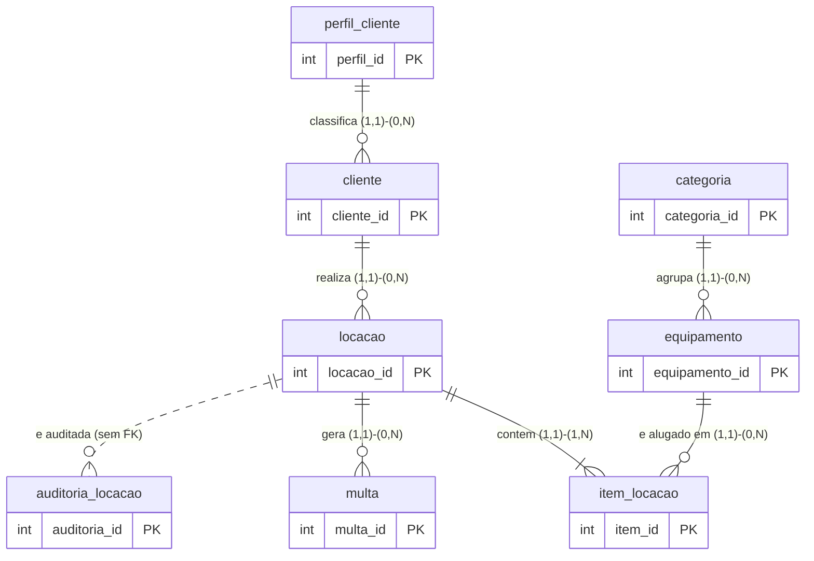

| Relacionamento | Cardinalidade (mín., máx.) |
|---|---|
| perfil_cliente — cliente | (1,1) — (0,N) |
| cliente — locacao | (1,1) — (0,N) |
| categoria — equipamento | (1,1) — (0,N) |
| locacao — item_locacao | (1,1) — (**1**,N): toda locação tem ao menos um item |
| equipamento — item_locacao | (1,1) — (0,N): equipamento novo pode nunca ter sido alugado |
| locacao — multa | (1,1) — (0,N) |

## 3. Decisões de modelagem

- **`item_locacao` como entidade associativa.** Uma locação tem vários equipamentos e um equipamento aparece em várias locações (N:M). A tabela associativa guarda o que é *do par*: o valor da diária cobrada (preço pode mudar depois) e se houve avaria.
- **PK artificial (`IDENTITY`) em todas as tabelas.** Evita chaves naturais mutáveis (e-mail, código). A unicidade natural fica garantida por `UK` (`uk_cliente_email`, `uk_equip_codigo`).
- **`perfil_cliente` é tabela, não atributo.** O limite de itens (RN-02) é dado de negócio que muda sem alterar código: trocar PADRAO de 3 para 4 é um `UPDATE`.
- **`multa` é entidade própria, não atributo da locação.** Uma locação pode ter multa de ATRASO e de AVARIA; cada uma tem status (ABERTA/PAGA) e é o que o RN-03 consulta. `UK(locacao_id, tipo)` impede multa duplicada.
- **Status do equipamento na própria tabela** (`DISPONIVEL/ALUGADO/MANUTENCAO`), mantido pelo trigger e pela devolução: permite validar disponibilidade sem varrer `item_locacao`.
- **Atraso é derivado, não armazenado:** locação "atrasada" = `ABERTA` e `data_prevista < hoje`. Guardar o estado ATRASADA exigiria um job para atualizá-lo.
- **`auditoria_locacao` sem FK, de propósito:** o histórico deve sobreviver à exclusão da locação.
- **`ON DELETE`:** `CASCADE` só em `item_locacao → locacao` (item não existe sem a locação); `RESTRICT` nas demais, para nunca perder histórico financeiro (multas, clientes, equipamentos alugados).

### Normalização (justificada)

- **1FN:** todos os atributos são atômicos. Os equipamentos de uma locação ficam em **linhas** de `item_locacao`, não em colunas `item1, item2…`.
- **2FN:** em `item_locacao` a chave candidata é `(locacao_id, equipamento_id)`; `valor_diaria_cobrada` e `avaria` dependem **do par inteiro**. Descrição e preço de tabela dependem só do equipamento e ficam em `equipamento`.
- **3FN:** sem dependência transitiva. O limite de itens depende de `perfil_id` (não do cliente), e o nome da categoria depende de `categoria_id` (não do equipamento).
- **Duas desnormalizações deliberadas:**
  1. `item_locacao.valor_diaria_cobrada` copia o preço no momento da locação: reajustar `equipamento.valor_diaria` não pode alterar locações antigas (histórico financeiro).
  2. `equipamento.status` é derivável de `item_locacao` + `locacao`, mas fica gravado para validar a disponibilidade **travando uma única linha** (RN-04, concorrência) em vez de varrer as locações.
- **`IDENTITY` inteiro × UUID v7:** escolhemos `GENERATED BY DEFAULT AS IDENTITY` porque funciona igual nos dois bancos, gera índices menores e mais rápidos, e os ids nascem dentro do banco. UUID v7 só compensaria se os ids fossem gerados fora dele (sistemas distribuídos), o que não é o caso.

## 4. Como executar

Pré-requisito: **somente Docker**. O PostgreSQL sobe em segundos. O Oracle (extra opcional) usa ~2 GB de memória e leva 1–2 min na primeira subida.

**Caminho principal (PostgreSQL + Python):**

```bash
docker compose up -d --wait                        # PostgreSQL pronto: esquema, dados, procedures e índices
docker compose run --rm testes                     # testes automatizados no PostgreSQL
docker compose run --rm perf                       # mede EXPLAIN antes/depois dos índices (grava performance/explain_antes_depois.txt)
docker compose --profile apps run --rm app-python  # aplicação Python
docker compose down -v                             # derruba e apaga tudo (para testar do zero)
```

**Extras opcionais (Oracle e Java, sem ponto extra):**

```bash
docker compose --profile oracle up -d --wait                  # PostgreSQL + Oracle
docker compose --profile oracle run --rm testes-oracle        # testes nos DOIS bancos
docker compose --profile oracle run --rm perf-oracle          # EXPLAIN nos dois bancos
docker compose --profile oracle run --rm app-python-oracle    # app Python nos dois bancos
docker compose --profile oracle run --rm app-java             # app Java (JDBC) nos dois bancos
docker compose --profile oracle down -v                       # remove também o Oracle
```

> **Atenção:** os dados de exemplo usam datas relativas ao momento em que o banco foi criado. Um container antigo, mantido por dias, faz os testes de data falharem. Antes de testar ou apresentar, recrie tudo (`down -v` e `up -d --wait`; no Oracle, com `--profile oracle`).

Conexões de laboratório (senhas **apenas de laboratório**, definidas no `docker-compose.yml`):

| Banco | Host:porta | Usuário / senha | Banco/serviço |
|---|---|---|---|
| PostgreSQL | `localhost:5432` | `a3` / `a3lab` | `a3` |
| Oracle XE | `localhost:1521` | `a3` / `a3lab` | `XEPDB1` |

Se um script falhar na carga, a subida **aborta** (`ON_ERROR_STOP`, `WHENEVER SQLERROR EXIT` e checagem de `USER_ERRORS` no Oracle): não há erro silencioso.

### O que os testes cobrem (`tests/`: PostgreSQL no caminho principal; Oracle também, no extra)

- **Constraints:** `CHECK` de diária e de prazo (≤ 15 dias), `UNIQUE`, `FK`, `ON DELETE RESTRICT` e `CASCADE`.
- **Procedures:** caminho feliz, os 9 erros de negócio e valores-limite (prazo 15 × 16, 3º × 4º item, atraso 0 × 1 dia, teto de 50%).
- **Triggers:** bloqueio em `INSERT` direto, equipamento em manutenção, auditoria.
- **Concorrência:** duas sessões disputando o mesmo equipamento (a segunda espera o lock e recebe `EQL-005`).
- **Consultas:** resultados esperados calculados à parte + no extra com Oracle, **resultado idêntico nos dois bancos** para as 10 consultas.

### Evidências (prints)

| O que mostra | Print |
|---|---|
| Bancos *healthy* em `docker compose up -d --wait` | 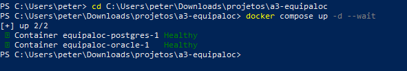 |
| Testes automatizados passando em `docker compose run --rm testes` | 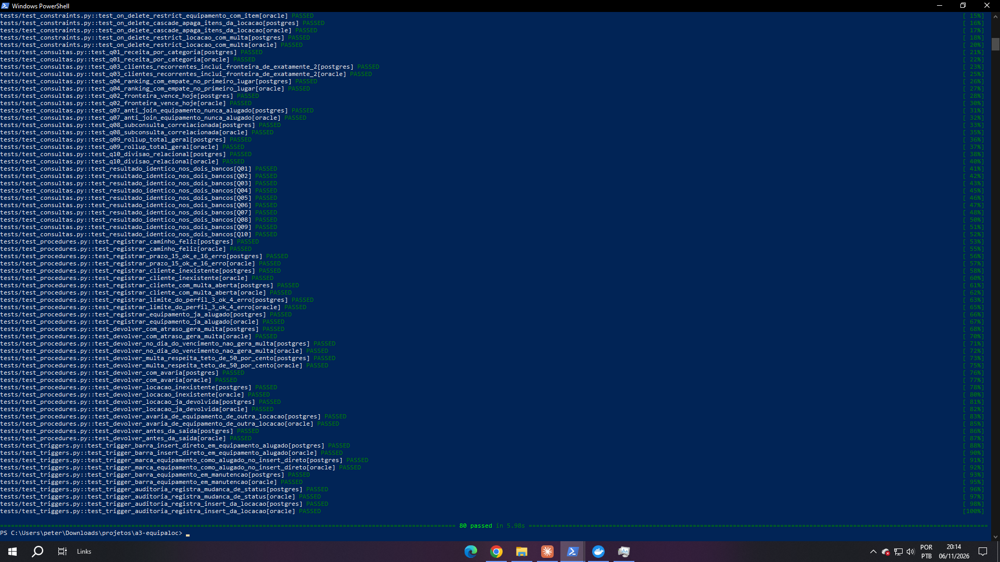 |
| Plano antes e depois, PostgreSQL | 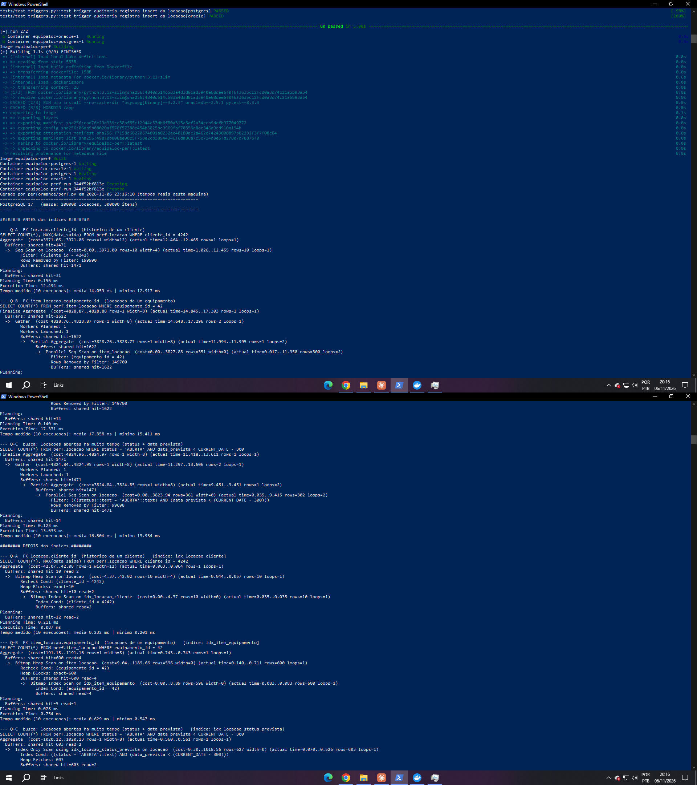 |
| Plano antes e depois, Oracle | 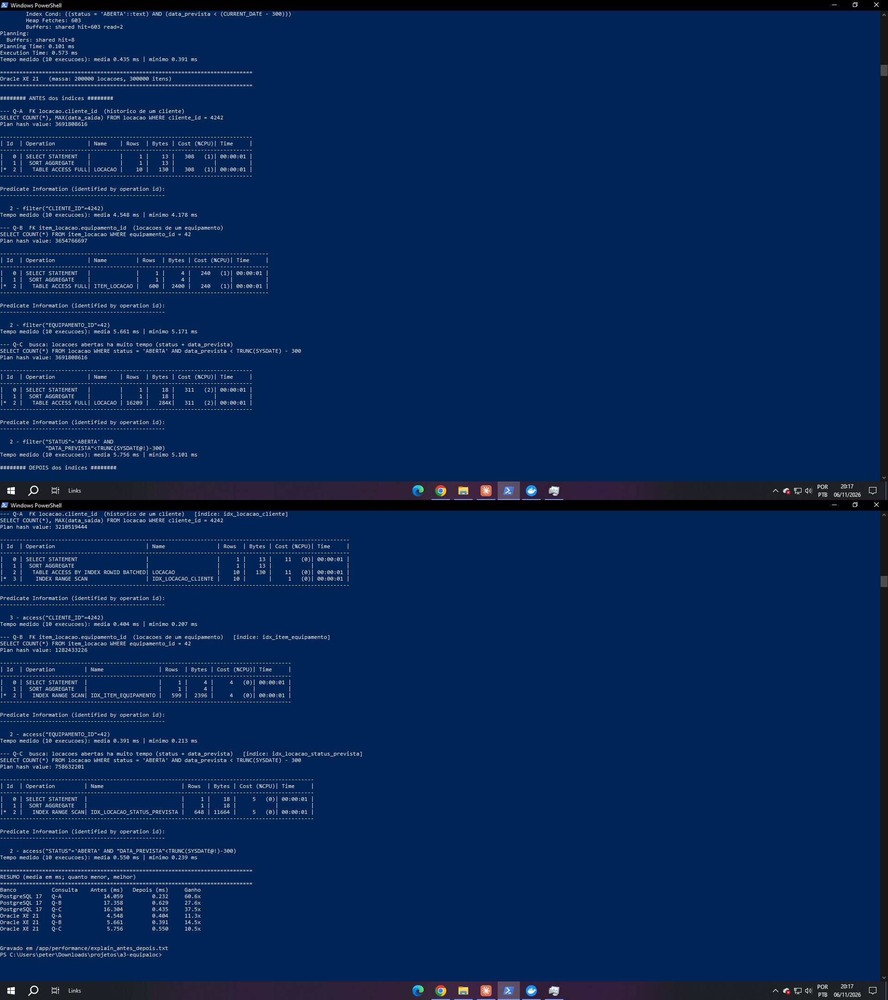 |
| Aplicação Python (bind, procedure, erro de negócio, rollback) | 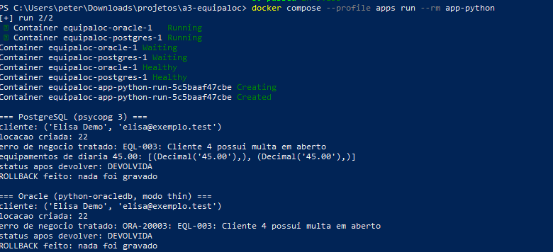 |
| Aplicação Java (JDBC) | 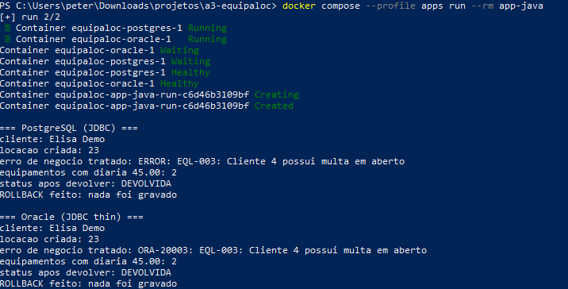 |
| DER gerado a partir do `.puml` | 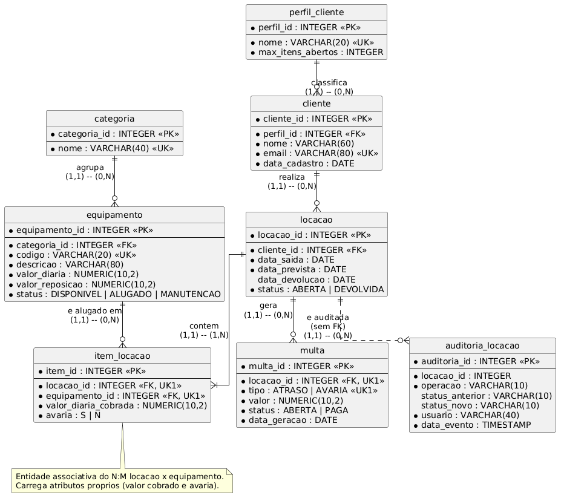 |
| Regra de negócio ao vivo e registro do trigger (`tools/demo_*.sql`) | 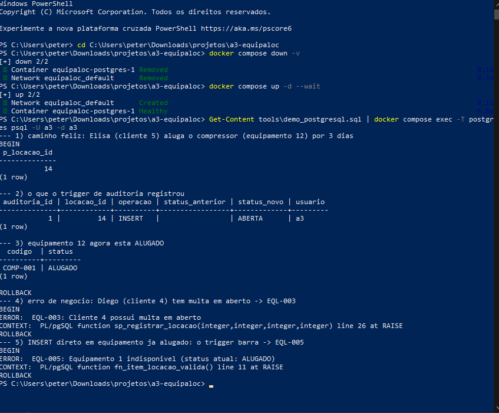 |
| Caminho principal: `down -v`, `up`, `testes` (**35 passed**) e início do app Python, só PostgreSQL | 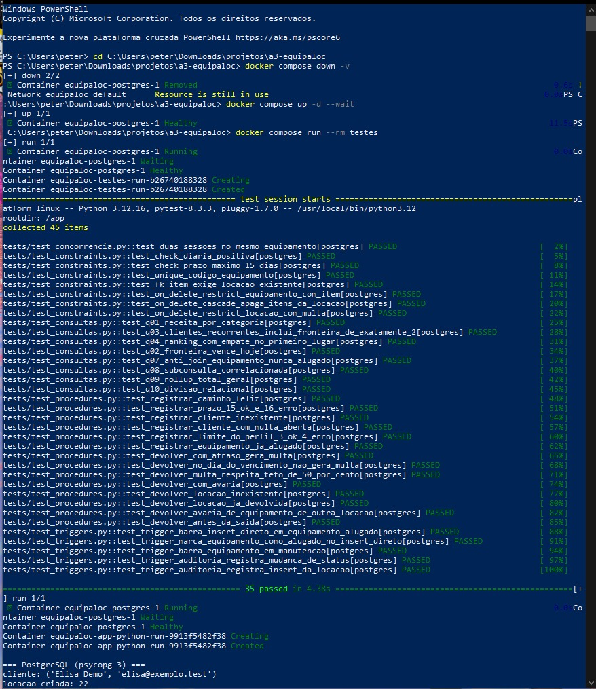 |
| App Python no PostgreSQL | 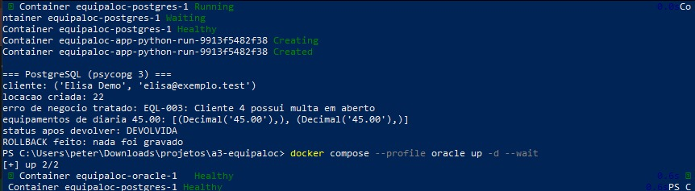 |
| Extra Oracle com container antigo: 4 testes de data falhando (erro registrado na linha 10) | 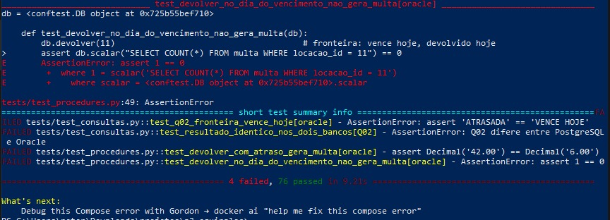 |

### Verificação por mutação (quebrar o SQL de propósito)

Para provar que os testes realmente protegem as regras, eu quebro uma regra, recria os bancos (`docker compose down -v` e `up -d --wait`), roda os testes e confirma que algum falha; depois desfaz a mudança.

| Mutação (o que foi quebrado) | Teste que falhou | Resultado |
|---|---|---|
| ⚠️ PREENCHER (ex.: trocar `>=` por `>` no limite do perfil em `sp_registrar_locacao`) | ⚠️ PREENCHER | ⚠️ PREENCHER |

## 5. Performance (índices e EXPLAIN)

Índices (`*/04_indices.sql`): `idx_locacao_cliente` (FK), `idx_item_equipamento` (FK) e `idx_locacao_status_prevista` (busca). Nem o PostgreSQL nem o Oracle indexam FK automaticamente; a FK `item_locacao.locacao_id` já é coberta pela `UK(locacao_id, equipamento_id)`.

A massa de dados (200 mil locações, 300 mil itens) é criada em **esquema à parte** (`perf` no PostgreSQL, usuário `a3_perf` no Oracle) por `performance/perf.py`, que grava os planos e tempos em [`performance/explain_antes_depois.txt`](performance/explain_antes_depois.txt).

Medido em 06/11/2026 com o `perf` (esta medição incluiu os dois bancos; as linhas do Oracle vêm do extra opcional; Docker Desktop, WSL 2, Windows 10, 16 GB de RAM). Tempos em ms: **média de 10 execuções**. Planos completos em [`performance/explain_antes_depois.txt`](performance/explain_antes_depois.txt).

| Consulta | Banco | Antes (ms) | Depois (ms) | Ganho | Plano antes → depois |
|---|---|---|---|---|---|
| Q-A FK `cliente_id` | PostgreSQL | 14,059 | 0,232 | 60,6x | Seq Scan → Bitmap Index Scan em `idx_locacao_cliente` |
| Q-A FK `cliente_id` | Oracle | 4,548 | 0,404 | 11,3x | TABLE ACCESS FULL → INDEX RANGE SCAN em `IDX_LOCACAO_CLIENTE` |
| Q-B FK `equipamento_id` | PostgreSQL | 17,358 | 0,629 | 27,6x | Parallel Seq Scan → Bitmap Index Scan em `idx_item_equipamento` |
| Q-B FK `equipamento_id` | Oracle | 5,661 | 0,391 | 14,5x | TABLE ACCESS FULL → INDEX RANGE SCAN em `IDX_ITEM_EQUIPAMENTO` |
| Q-C busca `status`+`data_prevista` | PostgreSQL | 16,304 | 0,435 | 37,5x | Parallel Seq Scan → Index Only Scan em `idx_locacao_status_prevista` |
| Q-C busca `status`+`data_prevista` | Oracle | 5,756 | 0,550 | 10,5x | TABLE ACCESS FULL → INDEX RANGE SCAN em `IDX_LOCACAO_STATUS_PREVISTA` |

Nos dois bancos os três índices foram usados pelo otimizador e reduziram o tempo. O PostgreSQL ganhou mais em termos relativos porque a varredura completa dele era mais lenta nesta máquina (14 a 17 ms contra 4,5 a 5,8 ms no Oracle).

### Planos de execução (trecho real do `explain_antes_depois.txt`, consulta Q-A)

Texto copiado sem alterações da saída do `perf` (as três consultas completas estão no arquivo).

**PostgreSQL, antes dos índices:**

```text
--- Q-A  FK locacao.cliente_id  (historico de um cliente)
SELECT COUNT(*), MAX(data_saida) FROM perf.locacao WHERE cliente_id = 4242
Aggregate  (cost=3971.05..3971.06 rows=1 width=12) (actual time=12.464..12.465 rows=1 loops=1)
  Buffers: shared hit=1471
  ->  Seq Scan on locacao  (cost=0.00..3971.00 rows=10 width=4) (actual time=1.026..12.455 rows=10 loops=1)
        Filter: (cliente_id = 4242)
        Rows Removed by Filter: 199990
        Buffers: shared hit=1471
Planning:
  Buffers: shared hit=31
Planning Time: 0.156 ms
Execution Time: 12.494 ms
Tempo medido (10 execucoes): media 14.059 ms | minimo 12.917 ms
```

**PostgreSQL, depois dos índices:**

```text
--- Q-A  FK locacao.cliente_id  (historico de um cliente)   [indice: idx_locacao_cliente]
SELECT COUNT(*), MAX(data_saida) FROM perf.locacao WHERE cliente_id = 4242
Aggregate  (cost=42.07..42.08 rows=1 width=12) (actual time=0.063..0.064 rows=1 loops=1)
  Buffers: shared hit=10 read=2
  ->  Bitmap Heap Scan on locacao  (cost=4.37..42.02 rows=10 width=4) (actual time=0.044..0.057 rows=10 loops=1)
        Recheck Cond: (cliente_id = 4242)
        Heap Blocks: exact=10
        Buffers: shared hit=10 read=2
        ->  Bitmap Index Scan on idx_locacao_cliente  (cost=0.00..4.37 rows=10 width=0) (actual time=0.035..0.035 rows=10 loops=1)
              Index Cond: (cliente_id = 4242)
              Buffers: shared read=2
Planning:
  Buffers: shared hit=12 read=2
Planning Time: 0.211 ms
Execution Time: 0.087 ms
Tempo medido (10 execucoes): media 0.232 ms | minimo 0.201 ms
```

**Oracle, antes dos índices:**

```text
--- Q-A  FK locacao.cliente_id  (historico de um cliente)
SELECT COUNT(*), MAX(data_saida) FROM locacao WHERE cliente_id = 4242
Plan hash value: 3691808616
 
------------------------------------------------------------------------------
| Id  | Operation          | Name    | Rows  | Bytes | Cost (%CPU)| Time     |
------------------------------------------------------------------------------
|   0 | SELECT STATEMENT   |         |     1 |    13 |   308   (1)| 00:00:01 |
|   1 |  SORT AGGREGATE    |         |     1 |    13 |            |          |
|*  2 |   TABLE ACCESS FULL| LOCACAO |    10 |   130 |   308   (1)| 00:00:01 |
------------------------------------------------------------------------------
 
Predicate Information (identified by operation id):
---------------------------------------------------
 
   2 - filter("CLIENTE_ID"=4242)
Tempo medido (10 execucoes): media 4.548 ms | minimo 4.178 ms
```

**Oracle, depois dos índices:**

```text
--- Q-A  FK locacao.cliente_id  (historico de um cliente)   [indice: idx_locacao_cliente]
SELECT COUNT(*), MAX(data_saida) FROM locacao WHERE cliente_id = 4242
Plan hash value: 3210519444
 
------------------------------------------------------------------------------------------------------------
| Id  | Operation                            | Name                | Rows  | Bytes | Cost (%CPU)| Time     |
------------------------------------------------------------------------------------------------------------
|   0 | SELECT STATEMENT                     |                     |     1 |    13 |    11   (0)| 00:00:01 |
|   1 |  SORT AGGREGATE                      |                     |     1 |    13 |            |          |
|   2 |   TABLE ACCESS BY INDEX ROWID BATCHED| LOCACAO             |    10 |   130 |    11   (0)| 00:00:01 |
|*  3 |    INDEX RANGE SCAN                  | IDX_LOCACAO_CLIENTE |    10 |       |     1   (0)| 00:00:01 |
------------------------------------------------------------------------------------------------------------
 
Predicate Information (identified by operation id):
---------------------------------------------------
 
   3 - access("CLIENTE_ID"=4242)
Tempo medido (10 execucoes): media 0.404 ms | minimo 0.207 ms
```


## 6. Dificuldades e aprendizados

**Diferenças PostgreSQL × Oracle tratadas neste projeto** (o Oracle é o extra opcional) (todas visíveis nos scripts):

| Ponto | PostgreSQL | Oracle |
|---|---|---|
| Tipos | `VARCHAR`, `NUMERIC`, `INTEGER` | `VARCHAR2`, `NUMBER` |
| `ON DELETE RESTRICT` | aceito | **não existe**; omitir a cláusula já bloqueia (`ORA-02292`) |
| "Hoje" | `CURRENT_DATE` | `TRUNC(SYSDATE)` (o `DATE` do Oracle guarda hora) |
| Procedure com saída | `INOUT` + `CALL` | parâmetro `OUT` |
| Erro de negócio | `RAISE EXCEPTION` | `RAISE_APPLICATION_ERROR(-20001…-20009)` |
| Erro de compilação PL/SQL | aborta o script | **não aborta**: checamos `USER_ERRORS` |
| Linhas de `INSERT` | `VALUES (...),(...)` | sem multi-linha: 1 `INSERT` por linha (IDENTITY na ordem) |
| Trigger consultando a própria tabela | permitido | `ORA-04091` (tabela mutante): por isso o trigger consulta `equipamento`, não `item_locacao` |
| Erro dentro da transação | aborta a transação (usar `SAVEPOINT`) | não aborta |

**Reflexão:** ⚠️ PREENCHER (o que foi mais difícil, o que aprendi, o que faria diferente).

## 7. Estrutura de diretórios

```
equipaloc/
├── README.md                     # este arquivo (com a seção "Uso de IA")
├── AGENTS.md                     # memória do projeto para o agente
├── opencode.json                 # permissões do agente (push negado)
├── docker-compose.yml            # PostgreSQL (principal) + Oracle e Java (extras opcionais)
├── der/equipaloc.puml            # DER em PlantUML
├── oracle/        # extra opcional
│                  01_ddl.sql  02_inserts.sql  03_consultas.sql  04_indices.sql
├── postgresql/    01_ddl.sql  02_inserts.sql  03_consultas.sql  04_indices.sql
├── procedures/    oracle_procedures.sql  postgresql_procedures.sql   # 2 procedures + 2 triggers
├── performance/   perf.py  explain_antes_depois.txt
├── docs/prints/   evidências (capturas de tela citadas no README)
├── tests/         conftest.py  test_constraints|procedures|triggers|concorrencia|consultas.py
├── python/        app.py                 # psycopg + python-oracledb
├── java/          pom.xml  Dockerfile   # extra opcional (JDBC)
│   └── src/app/   Main  Conexao  LocacaoDao (base)  LocacaoDaoPostgres  LocacaoDaoOracle
├── docker/        postgres/init.sh  oracle/init.sh  python/Dockerfile
└── tools/         gen_seed.py  demo_postgresql.sql  demo_oracle.sql  GUIA_EXECUCAO_E_DEFESA.md
```

---

## Uso de IA

**Ferramenta e modelo:** Claude (Anthropic), modelo Claude Sonnet 5.5, via chat (claude.ai). Sem skills. O `AGENTS.md` e o `opencode.json` estão versionados conforme a política da disciplina.

**Confirmações do professor (resposta por e-mail):** o trabalho pode ser entregue de forma individual; pode-se usar qualquer *harness* e modelo de IA; o agente pode rascunhar os artefatos desde que eu execute, revise e saiba explicar; pode-se usar qualquer imagem e tecnologia de container (Docker, Podman, Swarm etc.); e o registro pode ter etapas sem erro, desde que haja erros reais do agente registrados.

**Como foi usado:** o agente escreveu os rascunhos de todos os artefatos; eu **executei tudo no PostgreSQL e também no Oracle (extra)**, corrigi o que falhou e revisei. O agente não tem acesso ao Docker nem aos bancos, então nada foi validado por ele em execução.

| # | Artefato | Pedido (resumo) | O que o agente errou ou omitiu | O que eu fiz |
|---|---|---|---|---|
| 1 | Tema e regras de negócio | Propor temas válidos e 6 regras com números | Nenhum erro identificado | Escolhi o tema EquipaLoc entre as opções propostas; **tema aprovado pelo professor por e-mail** |
| 2 | DER | Entidades, cardinalidades (mín., máx.) e N:M | Nenhum erro identificado | Revisou o DER contra o checklist do enunciado |
| 3 | DDL (Oracle e PostgreSQL) | Constraints nomeadas, `ON DELETE`, tipos de cada dialeto | Nenhum erro na execução: subiu nos dois bancos na primeira vez | Executou `docker compose up -d --wait` e conferiu que os dois bancos ficaram *healthy* |
| 4 | Consultas | 10 consultas (JOIN, window, agregação, anti-join, ROLLUP, divisão relacional) | Nenhum erro na execução: resultado idêntico nos dois bancos | Executou os testes (`80 passed`) |
| 5 | Procedures e triggers | RN-01 a RN-06, erro de negócio, sem COMMIT, concorrência | Nenhum erro na execução: 9 erros de negócio, valores-limite e concorrência passaram nos dois bancos | Executou os testes e conferiu os códigos `EQL-001` a `EQL-009` |
| 6 | Índices e EXPLAIN | 3 índices e script de medição | **O script `perf.py` usava `DROP SCHEMA` e `DROP TABLE`**, o que a regra 3 do enunciado proíbe por sugestão do agente | Perguntei se o roteiro do enunciado tinha sido seguido; o agente identificou o `DROP`, removeu e passou a abortar com instrução de `docker compose down -v`; rodei o script e colou os tempos reais |
| 7 | Aplicações Java e Python | Bind, chamada de procedure, erro tratado | **Java entregue todo em um único `Main.java`**, difícil de explicar e de manter | Notei o arquivo único e pedi a separação; o agente dividiu em 5 classes (`Conexao`, `LocacaoDao` e uma subclasse por banco, `Main`) |
| 8 | README | Documentar os 7 blocos e a seção de IA | **Omitiu a normalização justificada** (aulas 16 e 17 do roteiro) | Comparei o trabalho com o roteiro do enunciado; o agente acrescentou a seção "Normalização (justificada)" |
| 9 | Aplicação Python | Mesmo fluxo da aplicação Java (bind, procedure, erro tratado, rollback) | **A mensagem de erro do Oracle saía com o prefixo duplicado** (`ORA-20003: ORA-20003: EQL-003…`), visto na execução | Executei o app e vi a saída; o agente corrigiu o `print` para não repetir o prefixo |
| 10 | Docker Compose (extras opcionais) | Colocar Oracle e Java atrás de um perfil do compose | **Não avisou que o `down -v` deixaria de remover o container do Oracle.** Um Oracle antigo continuou rodando com dados criados 6 dias antes e 4 testes que dependem de data falharam (76 passed, 4 failed) | Executei o extra e li as falhas; o agente diagnosticou a causa (a diferença de 6 dias batia com a data do container antigo) e passou a documentar `docker compose --profile oracle down -v` e o aviso sobre datas relativas |

> Regra do registro: **pelo menos 2 linhas** precisam trazer um **erro real** que apareceu ao executar e foi corrigido (a coluna "o que o agente errou"). Anotar na hora, com a mensagem de erro copiada.

**Reflexão:** ⚠️ PREENCHER (onde a IA mais ajudou, onde mais errou, o que eu faria diferente).
